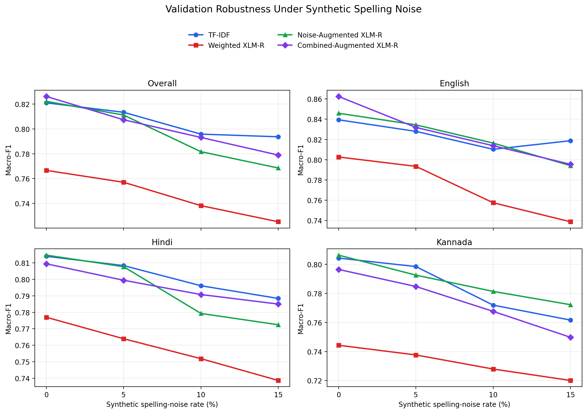
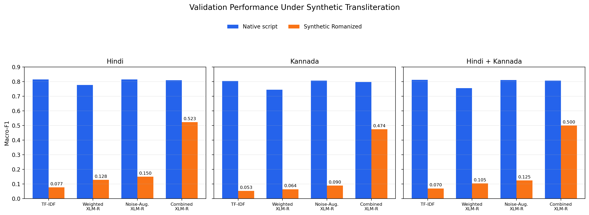
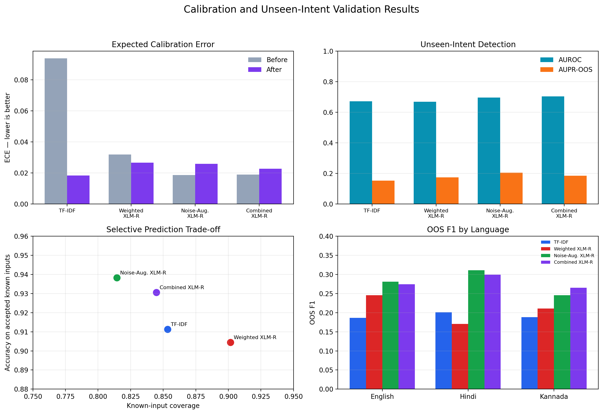

# Robust and Calibrated Multilingual Intent Classification

A reproducible NLP project studying multilingual intent classification under spelling noise, transliterated input, unseen intents, and uncertainty-aware rejection.

## Current scope

Languages:

- English (`en-US`)
- Hindi (`hi-IN`)
- Kannada (`kn-IN`)

## Dataset

The project uses the public [MASSIVE 1.1 dataset](https://github.com/alexa/massive), licensed under CC BY 4.0. Dataset files are downloaded when required and are not stored in this repository.

Verified statistics:

- 49,563 examples across the selected languages
- 60 original intents
- 50 known training intents
- 5 validation-OOS intents
- 5 separate test-OOS intents
- Official dataset partitions preserved
- No held-out intent leakage into training

The frozen intent groups are stored in [`configs/intent_split.json`](configs/intent_split.json).

## Phase 1 verified baseline

Model: word-and-character TF-IDF with logistic regression.

| Evaluation group | Accuracy | Macro-F1 |
|---|---:|---:|
| Overall validation | 0.8369 | 0.8210 |
| English | 0.8594 | 0.8394 |
| Hindi | 0.8308 | 0.8140 |
| Kannada | 0.8205 | 0.8043 |

Training completed in 61.8 seconds. The solver converged after 115 iterations. The test set has not been evaluated.

## Phase 2 verified multilingual models

Two XLM-R-base models were fine-tuned for two epochs using the same 50 known intents.

| Model | Validation accuracy | Validation macro-F1 |
|---|---:|---:|
| TF-IDF baseline | 0.8369 | **0.8210** |
| Clean XLM-R | 0.8453 | 0.7625 |
| Weighted XLM-R | **0.8522** | 0.7667 |

Weighted XLM-R improved over clean XLM-R across all three languages:

| Language | Clean XLM-R macro-F1 | Weighted XLM-R macro-F1 |
|---|---:|---:|
| English | 0.7899 | **0.8027** |
| Hindi | 0.7559 | **0.7770** |
| Kannada | 0.7307 | **0.7443** |

TF-IDF remains the strongest clean-text model by macro-F1. Weighted XLM-R is retained for later robustness and transliteration comparisons. Large checkpoints are stored outside GitHub in Google Drive.

## Repository structure

- `configs/`: experiment configurations
- `docs/`: documentation
- `notebooks/`: Colab notebooks
- `results/metrics/`: evaluation metrics
- `results/figures/`: plots
- `src/`: reusable project code
- `ui/`: final interface

Datasets, secrets, environments, and model checkpoints are excluded from Git.

## Current status

- [x] Dataset verification
- [x] Leakage-safe OOS split
- [x] TF-IDF validation baseline
- [x] XLM-R multilingual model
- [ ] Noise robustness evaluation
- [ ] Transliteration diagnostic
- [ ] OOS detection and calibration
- [ ] Final test evaluation
- [ ] Professional interface

Only verified experimental results are reported.

<!-- SPELLING_NOISE_RESULTS_START -->
## Phase 3 — Synthetic spelling-noise robustness

Four models were evaluated under deterministic Unicode-aware spelling noise using single-grapheme deletion and adjacent-grapheme transposition.

The final combined model was trained on 38,127 examples: clean training data, balanced spelling-noise copies, balanced Romanized Hindi and Kannada examples, and matching English control copies. Each language contributes exactly 12,709 training rows.

| Model | Noise | Accuracy | Macro-F1 | Drop from clean |
|---|---:|---:|---:|---:|
| TF-IDF | 0% | 0.8369 | 0.8210 | 0.0000 |
| TF-IDF | 5% | 0.8283 | 0.8133 | 0.0076 |
| TF-IDF | 10% | 0.8177 | 0.7958 | 0.0252 |
| TF-IDF | 15% | 0.8062 | 0.7937 | 0.0273 |
| Weighted XLM-R | 0% | 0.8522 | 0.7667 | 0.0000 |
| Weighted XLM-R | 5% | 0.8365 | 0.7571 | 0.0096 |
| Weighted XLM-R | 10% | 0.8220 | 0.7383 | 0.0284 |
| Weighted XLM-R | 15% | 0.8075 | 0.7253 | 0.0413 |
| Noise-Augmented XLM-R | 0% | 0.8635 | 0.8221 | 0.0000 |
| Noise-Augmented XLM-R | 5% | 0.8516 | 0.8111 | 0.0110 |
| Noise-Augmented XLM-R | 10% | 0.8404 | 0.7817 | 0.0405 |
| Noise-Augmented XLM-R | 15% | 0.8280 | 0.7685 | 0.0536 |
| Combined-Augmented XLM-R | 0% | 0.8622 | 0.8261 | 0.0000 |
| Combined-Augmented XLM-R | 5% | 0.8505 | 0.8073 | 0.0188 |
| Combined-Augmented XLM-R | 10% | 0.8391 | 0.7931 | 0.0330 |
| Combined-Augmented XLM-R | 15% | 0.8270 | 0.7789 | 0.0472 |

The combined model produces the highest clean macro-F1. TF-IDF retains the highest macro-F1 at 5%, 10%, and 15% spelling noise, demonstrating that the classical character-aware baseline remains highly competitive under orthographic corruption.

These results use controlled synthetic perturbations and do not establish performance on naturally occurring typing errors. The final test set remained untouched during model development.

<!-- SPELLING_NOISE_RESULTS_END -->

<!-- TRANSLITERATION_RESULTS_START -->
## Phase 4 — Synthetic transliteration robustness

Hindi and Kannada validation utterances were converted into simplified Latin text using `indic-transliteration` 2.3.82 with deterministic ITRANS-to-ASCII normalization. English was retained unchanged as a control.

| Model | Hindi native | Hindi Romanized | Kannada native | Kannada Romanized | Combined native | Combined Romanized |
|---|---:|---:|---:|---:|---:|---:|
| TF-IDF | 0.8140 | 0.0769 | 0.8043 | 0.0532 | 0.8121 | 0.0700 |
| Weighted XLM-R | 0.7770 | 0.1282 | 0.7443 | 0.0645 | 0.7552 | 0.1045 |
| Noise-Augmented XLM-R | 0.8147 | 0.1503 | 0.8064 | 0.0897 | 0.8101 | 0.1246 |
| Combined-Augmented XLM-R | 0.8094 | 0.5228 | 0.7965 | 0.4736 | 0.8064 | 0.4998 |

Without transliteration-aware training, all models fail severely on Romanized Hindi and Kannada. Combined augmentation raises the Hindi-and-Kannada Romanized macro-F1 from the previous best of 0.1246 to 0.4998 while maintaining strong native-script performance.

Synthetic scholarly transliteration does not capture the full variation of naturally typed Romanized Hindi or Kannada. These results should be interpreted as a controlled script-shift stress test.

<!-- TRANSLITERATION_RESULTS_END -->

<!-- OOS_CALIBRATION_RESULTS_START -->
## Phase 5 — Calibration and unseen-intent rejection

Validation data was divided into calibration and evaluation subsets using a deterministic SHA-256 split grouped by parallel example ID. Temperature and confidence thresholds were selected only on calibration data and measured on the separate evaluation subset.

One known intent, `audio_volume_other`, has no official validation examples. Validation classification metrics therefore cover the 49 known intents present while every model retains 50 output classes.

### Calibration

| Model | Temperature | ECE before | ECE after | NLL before | NLL after |
|---|---:|---:|---:|---:|---:|
| TF-IDF | 0.7398 | 0.0938 | 0.0184 | 0.6917 | 0.6381 |
| Weighted XLM-R | 0.9204 | 0.0319 | 0.0266 | 0.6223 | 0.6177 |
| Noise-Augmented XLM-R | 0.9655 | 0.0187 | 0.0259 | 0.5761 | 0.5757 |
| Combined-Augmented XLM-R | 0.9661 | 0.0189 | 0.0227 | 0.5821 | 0.5809 |

### Unseen-intent detection

| Model | Threshold | AUROC | AUPR-OOS | OOS F1 | Known coverage | Accepted-known accuracy |
|---|---:|---:|---:|---:|---:|---:|
| TF-IDF | 0.536 | 0.6717 | 0.1524 | 0.1920 | 0.8535 | 0.9113 |
| Weighted XLM-R | 0.567 | 0.6693 | 0.1739 | 0.2079 | 0.9016 | 0.9044 |
| Noise-Augmented XLM-R | 0.797 | 0.6960 | 0.2050 | 0.2788 | 0.8145 | 0.9382 |
| Combined-Augmented XLM-R | 0.728 | 0.7033 | 0.1848 | 0.2792 | 0.8447 | 0.9306 |

The combined model achieves the best AUROC and OOS F1 while retaining more known inputs than the noise-only augmented model. However, OOS F1 remains low, demonstrating that maximum class confidence is not a reliable standalone unseen-intent detector.

Combined-model OOS F1 is 0.2740 for English, 0.2991 for Hindi, and 0.2651 for Kannada.

<!-- OOS_CALIBRATION_RESULTS_END -->
